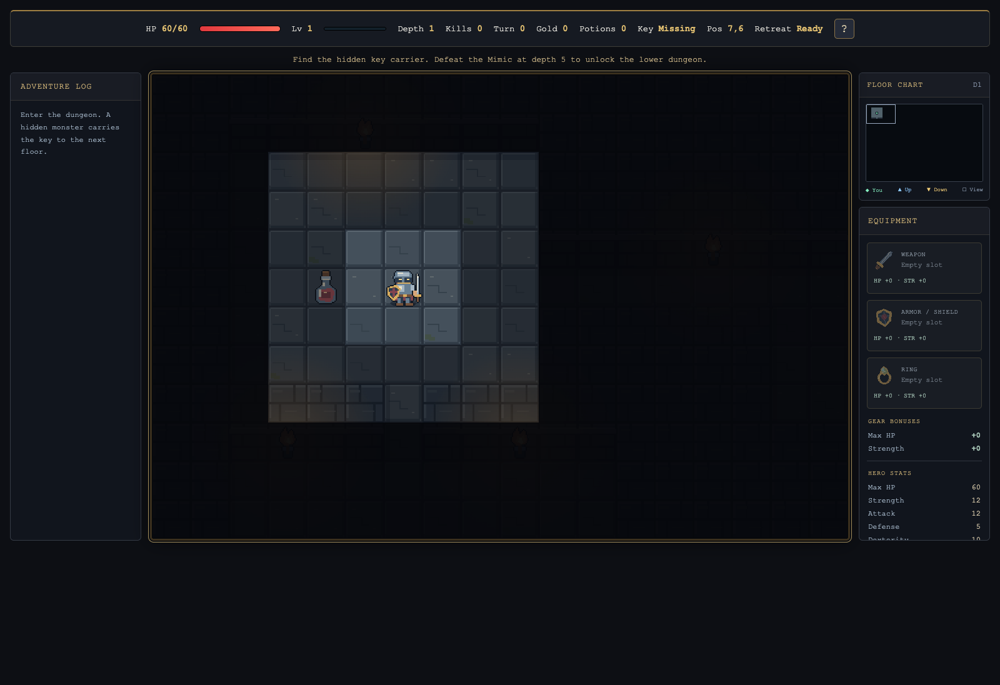
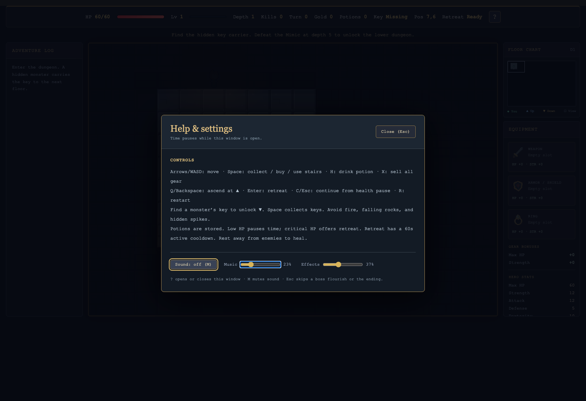
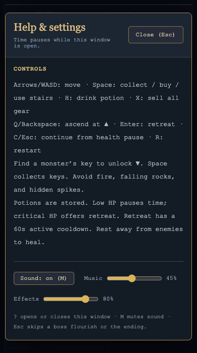

# Dungeon Crawler

Local LLM playground, tooks ~30h to get to v0.11.0 with "better" graphics

## used HW
1x Apple M1
1x Apple M5
1x PC with RTX 4070Ti

## LLM models
- inkling-2-mini
- qwen3
- gemma


A plain HTML5 canvas dungeon game, version 0.12.0. Open `index.html` directly in a browser (`file://`); there is no install, build step, server, or network dependency.

The fantasy logo and version appear on the launch screen only. Click **Enter the dungeon** or press a key to begin; the game waits until you start. During play, stats sit at the top and a scrolling adventure log sits to the left of the map, and equipment with icons and bonuses sits to its right. On narrow screens the log moves below the map. R starts a fresh run without showing the launch screen again; reloading the page shows it.

## Screenshots

Desktop gameplay at 2× zoom, with the adventure log, minimap, equipment, and HUD help button.



Help & settings opens with **?** or the HUD button and pauses play while you read instructions or adjust audio.



<details>
<summary>Mobile help window</summary>



</details>

## Graphics

The dungeon is displayed at **2× zoom**, with 18×12 tiles visible in the same canvas. Characters, tiles, loot, bubbles, warnings, and world health bars are twice as large. The camera follows you and the minimap outline tracks the smaller view. HUD/sidebar sizes and screen-space cinematic framing stay consistent.

The original pixel artwork uses worn slate masonry, recessed wall faces, moss/cracks, warm wall torches, and shaded full-body characters. Stairs, loot, equipment icons, and hazards share the same original pixel-art palette. [View the character, item, and dungeon design sheets](docs/previews/2026-11-23-static-graphics/index.html). The reference asset pack inspired the general direction; its artwork is not bundled.

Sprites and terrain variations are rasterized into small local canvas caches and reused, with crisp nearest-neighbor rendering. The four runtime files total about 179 KiB, with no external art/font/network loading and a capped animation drawing loop. Existing boss-defeat and ending scenes use the refreshed figures.

Movement now eases between tiles with walking poses. Bats and the dragon flap their wings, moving slimes hop and squash, and wall torches and active fire vents flicker. Animations freeze during Help, health/retreat pauses, and hidden tabs. Combat, collision, and trap timing still use the original logical tiles and gameplay clocks.

[Watch the movement, wing, and flame animation preview (WebM)](docs/previews/2026-11-23-movement/movement.webm).

## Controls

| Key | Action |
| --- | --- |
| ? / HUD ? button | Open or close Help & settings; pauses play |
| Esc in Help | Close Help & settings |
| Arrows / WASD | Move; attack by walking into a monster |
| Space | Collect a key/item, buy the first merchant item, rescue an NPC, or use the staircase under you |
| Q / Backspace | Ascend while standing on ▲ |
| H | Drink a stored potion |
| X | Sell all equipped gear while standing on the merchant |
| Enter | Request retreat during normal play |
| C / Escape | Continue from a health pause |
| Escape during the ending | Skip to the final sunset scene |
| Escape during a boss defeat | Skip the short victory flourish |
| T | Request retreat from the critical-health dialog |
| Y | Confirm a retreat; N / Escape cancels |
| M | Toggle music and effects |
| R | Restart the run |

Dialog buttons also work with mouse or Tab and Enter/Space.

## Exploration and recovery

Floors retain their layout, explored terrain, remaining items, merchant stock, and rescues when you leave. Ordinary monsters return at full health when you revisit; defeated bosses stay defeated. Your current XP, stats, gear, gold, inventory, kills, and turn count carry between floors. Collected treasure and potions stay collected. The descent reward is paid only once per floor.

Space on an unlocked ▼ goes down; Space on ▲ goes up. You arrive at the connecting staircase. Stairs, treasure chests, and potions remain visible on explored terrain; distant enemies stay hidden. These saves last for the current run only: restarting or reloading clears them.

Potions are stored when found or bought, rather than consumed automatically. H uses one and heals up to maximum HP; a full-health player does not waste a potion.

Below 20% HP, time pauses so you can drink or choose Continue. Below 10%, the dialog also offers Retreat. Drinking leaves the dialog open until you continue. Each warning triggers once until you recover to its threshold; lethal damage still ends the run. Enemies, healing, and the combat cooldown stop during pauses.

Retreat asks for confirmation, takes you one floor up, and restores full HP. On the first floor it restores you at that floor’s entrance. A confirmed retreat starts a 60-second cooldown shown in the HUD. It counts only active play time: pauses, hidden tabs, and changing floors do not clear it. Canceling a retreat does not consume it.

Resting restores 2% maximum HP (rounded, minimum 1 HP) every two seconds after six seconds without combat, provided no living monster is within three tiles. Paused or hidden-tab time does not accumulate healing or cooldown time.

Sound starts after your first keyboard/button interaction if browser audio is available. Music and effects are synthesized locally; M or the Sound button mutes both. Separate Music and Effects sliders adjust their volume independently. Mute silences both, and adjusting a slider while muted keeps them muted. Volume and mute choices survive R within the current page. The Sound button and volume sliders live in **Help & settings**: press **?** or click the HUD **?** button. Close with **?**, **Esc**, or **Close**; focus returns to the previous control or game. Gameplay and cinematic clocks pause while help is open, and an existing health/retreat dialog resumes afterward. There is no permanent help/audio footer. Merchant stock appears in the equipment panel; ending buttons appear over the ending canvas.

## Larger floors, keys, and hazards

Each floor is **72×48 tiles**, larger than the **18×12-tile viewport at 2× zoom**. The camera follows you and stops at the world edges; HUD, log, and equipment stay in place. Rooms connect through branching corridors and loops. Pillars and rubble block movement, and generation checks that all remaining floor tiles and important objects stay reachable. The HUD shows your world position.

The **Floor chart** above the equipment on the right shows explored terrain for the current floor. Green marks you, blue/gold mark discovered up/down stairs, and the pale outline shows the main camera area. Unexplored terrain, monsters, items, keys, and traps are hidden. Exploration returns when you revisit a floor; R/reload clears it. The chart stacks below the map/log on narrow screens.

On floors 1–9, one random ordinary monster secretly carries that floor’s key. There is no carrier icon. Defeat it to drop a golden key, then stand on the drop and press Space. This permanently unlocks that floor’s down stairs. The key is collected before using stairs or interacting with an NPC on the same tile. Drops, collection, and unlocks survive revisits; returning monsters do not duplicate them. The Key HUD shows Missing, Dropped, or Unlocked. Depth 10 has no further descent and needs no floor key; dragon defeat still unlocks the princess rescue.

- **Flame vents** are visible and cycle on/off every three seconds. Active flames deal `4 + depth` damage at most once per second while you stand there.
- **Falling-rock tiles** show cracks. Entering starts a 1.2-second warning with falling stones and a visible badge above your character. Move away before impact to avoid `8 + 2 × depth` damage. Spent debris stays passable.
- **Hidden spikes** have no visual marker until stepped on. They deal `6 + depth` damage once, then remain visible and spent.

Hazards stay off arrivals/stairs and their surrounding three tiles, as well as initial NPC/loot/monster positions. All trap damage uses the existing low-health pauses and death handling. Shields reduce monster attacks, not environmental damage. Trap clocks stop while paused, on the launch screen, in a hidden tab, or on a different floor. Triggered traps and local timers persist across floor travel.

## Campaign and combat

The objective below the HUD tracks a ten-floor campaign:

1. Find each floor’s key to descend. At depth 5, also defeat the Mimic to unlock the lower dungeon.
2. Reach depth 10 and defeat the dragon. Its death unlocks the princess rescue; the game continues.
3. Stand on the princess and press Space to complete the campaign and watch the animated ending. Esc skips it; R restarts.

The princess appears only at depth 10, and there is no depth 11. Defeated bosses stay defeated when you return, and their kill rewards cannot be collected twice. Ordinary monsters still respawn. Merchants appear at depths 2–4 and prisoners on even non-boss floors.

Combat remains real time. Each enemy shares a 0.8-second cooldown between retaliation and timed attacks, including dodges; different enemies can attack independently. Late-floor HP and attack scaling are gentler than before, while XP and gold progression are retained. Use gear, stored potions, retreat, and safe rest to prepare for the final encounter.

Living monsters trade short Monty Python quotes in speech bubbles when hit or attacking. One monster can speak every five active seconds; its bubble lasts five active seconds, follows it as the camera scrolls, and stays inside the viewport. Pauses and hidden tabs freeze speech timers. Dead, unseen, and offscreen monsters show no bubble; travel, respawn, restart, player death, and the ending clear it. NPC dialogue remains separate.

Each spoken quote also appears once in the left adventure log with the monster's name, so it remains readable after the bubble disappears.

Boss floors have larger chambers and three-tile-wide connecting halls. The Mimic has an 18×14-tile arena; the dragon has a 22×18-tile hall. Their central spawn areas stay clear of loot and ordinary monsters, and the arenas contain no traps or blocking props. The Mimic is three tiles wide; the winged, horned dragon spans nearly four tiles across and three high. Health bars and speech sit above the larger artwork. Their combat target and movement still use one tile.

Defeating a boss pauses play briefly for a victory flourish. The Mimic snaps shut, sprays coins, and collapses in place with a **MIMIC DEFEATED** banner. The dragon gets a screen-space cinematic: a darkened hall, lightning, embers, drooping wings, a falling dragon, and **DRAGON SLAIN**. Rewards, defeat flags, and objectives are applied immediately; Esc skips the flourish. The dragon animation clears before the later princess interaction starts the full ending.

The brief quotations are from *Monty Python and the Holy Grail*: [official Monty Python media](https://www.montypython.com/media), [Black Knight scene](https://www.youtube.com/watch?v=KlYrn2bXsc4), and [Knights Who Say Ni scene](https://www.youtube.com/watch?v=zIV4poUZAQo). Only text is included; no film audio or media assets are bundled.

## Ending

The final princess interaction starts a roughly 14-second canvas sequence. Dungeon simulation stops during the animation and the final scene. **Esc** or **Skip to sunset** jumps to the final scene; **R** or **New adventure** starts a fresh run. The generic victory overlay does not cover the animation. Switching away from the tab pauses its clock, and sound/mute controls still work.

<details>
<summary>Plot twist (spoilers)</summary>

The princess is in love with the dragon. She runs past the hero, heals her wounded partner, climbs onto him, and they fly away together. The heartbroken hero then walks toward the setting sun, shrinking into the distance and crying blue tears. The sunset holds with **THE END** and run stats.

</details>

## Equipment

The right sidebar shows weapon, armor/shield, and ring slots with icons, each item's modifiers, combined HP/strength bonuses, and effective hero stats.

- A **Sword** adds 6 attack and 2 strength; strength also contributes to attack, so its total attack increase is 8.
- A **Shield** occupies the armor slot and adds 5 defense, reducing monster hit damage by 5 compared with the same hero without that shield, down to the minimum of 1 damage. Armor and helmets remain alternative defensive gear.
- A **Ring** adds 20 maximum HP and 20 current HP when first equipped, plus its existing attack/defense/strength/dexterity modifiers. Replacing it with another equal ring does not stack or grant another heal. Removing or selling it removes the maximum-HP bonus and caps current HP at the resulting maximum.

Collecting or buying gear equips it; selling removes its modifiers. Floor changes preserve equipment and bonuses. HP and strength modifiers appear even when zero, and the hero stats show the resulting totals.

## Development and checks

Runtime files: `index.html`, `style.css`, `js/sprites.js`, and `js/game.js`. Both scripts share global scope; preserve their order and `file://` compatibility. See `agents.md`, `tasks.md`, and `handover.md` for project guidance and status.

Run the dependency-free checks with Node.js:

```sh
node --check js/game.js
node --check js/sprites.js
node --test tests/game.test.cjs
```

The existing environment-specific startup smoke test remains outside the repository:

```sh
node /var/folders/lp/737kz569419gglsqmvs0x0200000gn/T/opencode/smoke.js
```

Also check actual rendering, controls, dialogs, and sound in a browser after gameplay changes.
