# Dungeon Crawler

Local LLM playground, tooks ~30h to get to v0.11.0 with "better" graphics

## used HW
1x Apple M1
1x Apple M5
1x PC with RTX 4070Ti

## LLM models
- inkling-2-mini
- qwen3
- gemma


A plain HTML5 canvas dungeon game, **version 1.0.1** (reviewed 2026-11-24). Open `index.html` directly in a browser (`file://`); there is no install, build step, server, or network dependency.

The fantasy logo and version appear on the launch screen only. Click **Enter the dungeon** or press a key to begin; the game waits until you start. During play, stats sit at the top; Hero stats sit in a fixed compact panel above a fixed, internally scrolling adventure log (newest first) on the left of the map, and the floor chart with equipment and Spells under Gear bonuses sits to the right. On narrow screens the left and right panels stack below the map. R starts a fresh run without showing the launch screen again; reloading the page shows it.

[Changelog](CHANGELOG.md) · [Initial status review and known issues](docs/reviews/2026-11-24-status-review.md)

[JRPG graphics implementation and checks](docs/reviews/2026-11-24-jrpg-implementation.md)

## Screenshots

Current browser captures of the implemented JRPG artwork from the local `file://` build, 2026-11-24. The dungeon encounter below is prepared to show the new enemy types and learned spells; it is not a full campaign playthrough.

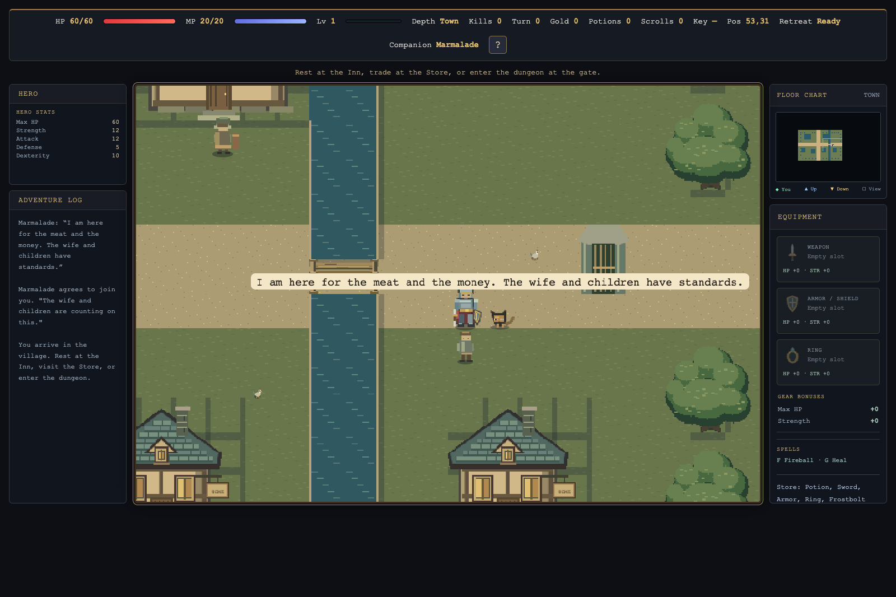

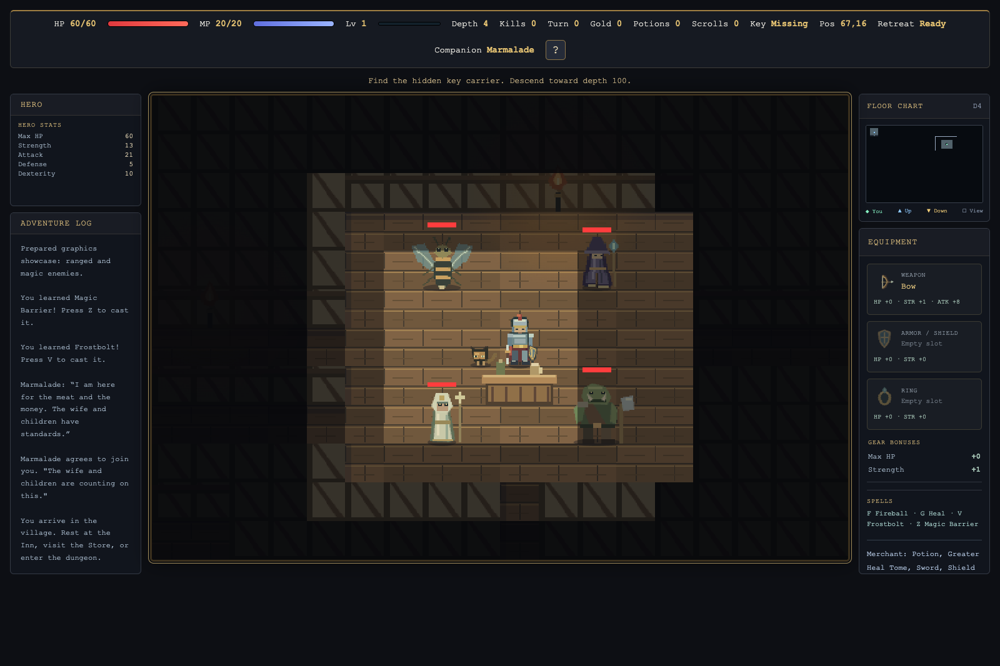

<details>
<summary>Village, Help & settings, and mobile help</summary>

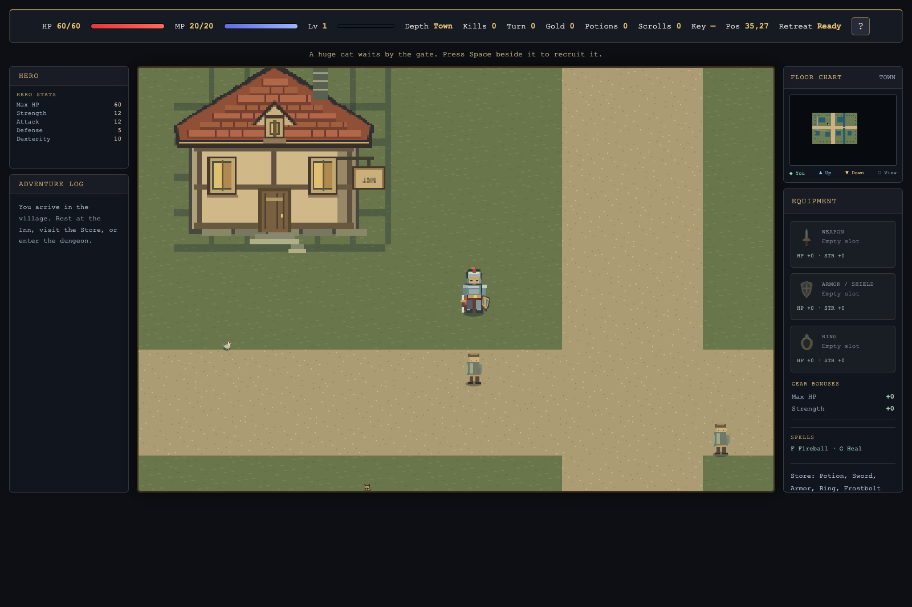

Help opens with **?** or the HUD button and pauses play.

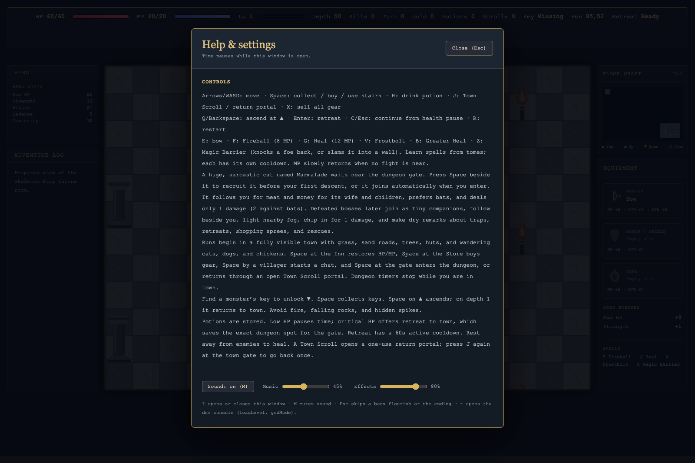

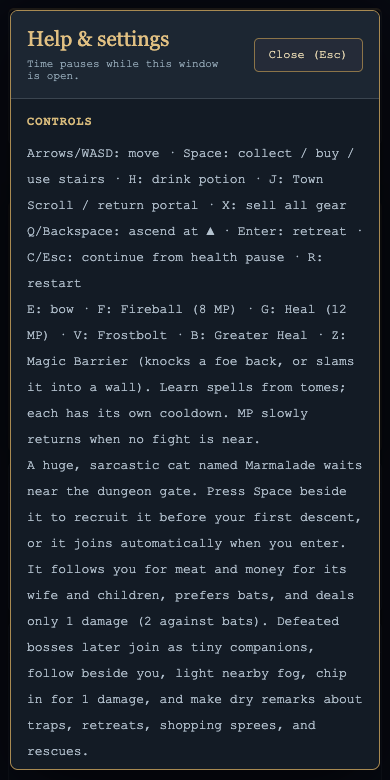

</details>

## Graphics

The dungeon is displayed at **2× zoom**, with 18×12 tiles visible in the same canvas. Characters, tiles, loot, bubbles, warnings, and world health bars are twice as large. The camera follows you and the minimap outline tracks the smaller view. HUD/sidebar sizes and screen-space cinematic framing stay consistent.

The approved classic JRPG refresh uses original detailed overhead pixel art: pitched roofs and timber facades, organic tree canopies, continuous grass/roads, raised masonry, distinct biome materials and full-body characters. The knight and humanoids have directional views; bosses, loot, equipment, stairs, hazards and spell effects share the same palette. [Approved focus design](docs/previews/2026-11-24-classic-jrpg/design-v3/index.html) · [Expanded artwork](docs/previews/2026-11-24-classic-jrpg/design-v3/collection/index.html). References inspired the direction; no third-party artwork is bundled.

The subsequent [wall readability fix](docs/reviews/2026-11-24-wall-rendering.md) joins neighboring walls and keeps their faces inside blocked tiles. Crypt floors now use chipped flagstones, making walkable corridors distinct from masonry. Earlier full-game captures above predate this correction; the review includes current before/after and corridor captures.

The checked-in sprite grids use compact run-length data and shared pose grids; no preview files or asset build are needed at runtime. Sprites, directional frames, equipment icons and coordinate-derived terrain are cached on local canvases with crisp nearest-neighbor rendering. The four runtime files total about 495 KiB, with no external art/font/network loading and a capped animation drawing loop. Existing boss-defeat and ending scenes use the refreshed figures.

Movement now eases between tiles with walking poses. Bats and the dragon flap their wings, moving slimes hop and squash, and wall torches and active fire vents flicker. Animations freeze during Help, health/retreat pauses, and hidden tabs. Combat, collision, and trap timing still use the original logical tiles and gameplay clocks.

[Watch the movement, wing, and flame animation preview (WebM)](docs/previews/2026-11-23-movement/movement.webm).

## Controls

| Key | Action |
| --- | --- |
| ? / HUD ? button | Open or close Help & settings; pauses play |
| Esc in Help | Close Help & settings |
| Arrows / WASD | Move; attack by walking into a monster |
| Space | In town, recruit Marmalade the cat, use the Inn, Store, villagers, or dungeon gate; in the dungeon, collect a key/item, buy the first merchant item, rescue an NPC, or use the staircase under you |
| Q / Backspace | Ascend while standing on ▲ |
| H | Drink a stored potion |
| E | Shoot the equipped Bow at the nearest eligible visible enemy |
| J | Use a Town Scroll in the dungeon; press again at the town gate to return through the open portal |
| F / G / V / B / Z | Cast Fireball, Heal, Frostbolt, Greater Heal, or Magic Barrier if learned (each costs MP) |
| X | Sell all equipped gear while standing on the merchant |
| Enter | Request retreat during normal play |
| C / Escape | Continue from a health pause |
| Escape during the ending | Skip to the final sunset scene |
| Escape during a boss defeat | Skip the short victory flourish |
| T | Request retreat from the critical-health dialog |
| Y | Confirm a retreat; N / Escape cancels |
| M | Toggle music and effects |
| R | Restart the run |
| ~ / ` | Open or close the developer console (pauses play) |

The developer console accepts `loadLevel <1-100>` to generate a fresh target floor (including boss floors) and `godMode 0|1` to freeze the hero's HP, MP, level, XP, and combat stats while leaving monsters fully active and one-shot killable by player attacks. `help` and `clear` are also available; `godMode` is shown in the HUD while active.

Dialog buttons also work with mouse or Tab and Enter/Space.

## Town hub

Runs begin in a small persistent village with grass, sand roads, a river, bridge, trees, huts, an Inn with a doorstep, a Store with a doorstep, wandering villagers, small cats/dogs/chickens, and a dungeon gate. A huge, sarcastic cat named Marmalade waits near the gate; Space beside it recruits it before the first descent, and it joins automatically if you leave without asking. The town is fully visible without dungeon fog, and the player stays drawn above townsfolk and animals. Space at the Inn fully restores HP and MP. Space at the Store buys the next item from stock that persists for the run, and X still sells equipped gear there. Standing near a villager prompts a line of dialogue; walking into a villager talks instead of overlapping them. Townspeople and animals patrol fixed routes, and villagers chat on approach. Space at the gate uses an open Town Scroll portal, returns to a saved retreat point when one exists, or enters depth 1 otherwise. A prepared portal glows at the gate. Dungeon monsters, traps, healing, mana regeneration, companion attacks, and active-time cooldowns do not advance in town. Retreat still follows the dungeon rules described below.

## Exploration and recovery

Floors retain their layout, explored terrain, remaining items, merchant stock, and rescues when you leave. Ordinary monsters return at full health when you revisit; defeated bosses stay defeated. Your current XP, stats, gear, gold, inventory, stored Town Scrolls, kills, and turn count carry between floors. Collected treasure and potions stay collected. The descent reward is paid only once per floor.

Space on an unlocked ▼ goes down; Space on ▲ goes up, and the ▲ on depth 1 returns to town. You arrive at the connecting staircase. Stairs, treasure chests, and potions remain visible on explored terrain; distant enemies stay hidden. These saves last for the current run only: restarting or reloading clears them.

Potions are stored when found or bought, rather than consumed automatically. H uses one and heals up to maximum HP; a full-health player does not waste a potion.

Town Scrolls are rare item drops and are also sold at the town Store. Pressing J in the dungeon consumes one, records the exact depth and tile, and opens a glow at the town gate. Press J there (or use Space at the gate) to return once; the portal then disappears. Only one portal can be open, and retreat, death, the ending, and restarting clear it without refunding the scroll. Dungeon travel while the portal is open does not move it.

Below 20% HP, time pauses so you can drink or choose Continue. Below 10%, the dialog also offers Retreat. Drinking leaves the dialog open until you continue. Each warning triggers once until you recover to its threshold; lethal damage still ends the run. Enemies, healing, and the combat cooldown stop during pauses.

Retreat asks for confirmation, returns you to town, and restores full HP without refilling MP. It saves the exact dungeon depth and tile you left, and the town gate returns you there once; any open Town Scroll portal collapses and is replaced. A confirmed retreat starts a 60-second cooldown shown in the HUD. It counts only active play time: pauses, hidden tabs, town time, and changing floors do not clear it. Canceling a retreat does not consume it.

Resting restores 2% maximum HP (rounded, minimum 1 HP) every two seconds after six seconds without combat, provided no living monster is within three tiles. Paused or hidden-tab time does not accumulate healing or cooldown time.

Sound starts after your first keyboard/button interaction if browser audio is available. Music and effects are synthesized locally; M or the Sound button mutes both. Separate Music and Effects sliders adjust their volume independently. Mute silences both, and adjusting a slider while muted keeps them muted. Volume and mute choices survive R within the current page. The Sound button and volume sliders live in **Help & settings**: press **?** or click the HUD **?** button. Close with **?**, **Esc**, or **Close**; focus returns to the previous control or game. Gameplay and cinematic clocks pause while help is open, and an existing health/retreat dialog resumes afterward. There is no permanent help/audio footer. Merchant stock appears in the equipment panel; ending buttons appear over the ending canvas.

## Larger floors, keys, and hazards

Each floor is **96×64 tiles** (about 32 rooms), larger than the **18×12-tile viewport at 2× zoom**. The camera follows you and stops at the world edges; HUD, log, and equipment stay in place. Rooms connect through branching corridors and loops. Pillars and rubble block movement, and generation checks that all remaining floor tiles and important objects stay reachable. The HUD shows your world position.

The **Floor chart** above the equipment on the right shows explored terrain for the current floor. Green marks you, blue/gold mark discovered up/down stairs, and the pale outline shows the main camera area. Unexplored terrain, monsters, items, keys, and traps are hidden. Exploration returns when you revisit a floor; R/reload clears it. The chart stacks below the map/log on narrow screens.

On floors 1–99, one random ordinary monster secretly carries that floor’s key. There is no carrier icon. Defeat it to drop a golden key, then stand on the drop and press Space. This permanently unlocks that floor’s down stairs. The key is collected before using stairs or interacting with an NPC on the same tile. Drops, collection, and unlocks survive revisits; returning monsters do not duplicate them. The Key HUD shows Missing, Dropped, or Unlocked. Depth 100 has no further descent and needs no floor key; the final dragon’s defeat unlocks the princess rescue.

- **Flame vents** are visible and cycle on/off every three seconds. Active flames deal `4 + depth` damage at most once per second while you stand there.
- **Falling-rock tiles** show cracks. Entering starts a 1.2-second warning with falling stones and a visible badge above your character. Move away before impact to avoid `8 + 2 × depth` damage. Spent debris stays passable.
- **Hidden spikes** have no visual marker until stepped on. They deal `6 + depth` damage once, then remain visible and spent.

Hazards stay off arrivals/stairs and their surrounding three tiles, as well as initial NPC/loot/monster positions. All trap damage uses the existing low-health pauses and death handling. Shields reduce melee monster damage; traps and the current ranged/magic damage branches bypass that defense reduction. Trap clocks stop while paused, on the launch screen, in a hidden tab, or on a different floor. Triggered traps and local timers persist across floor travel.

## Campaign and combat

The objective below the HUD tracks a 100-floor campaign. Bosses guard depths 5, 10, 20, 30, 40, 50, 60, 70, 80, 90, and 100; the HUD names only the boss on your current floor, keeping later encounters a surprise. Find each floor’s hidden key carrier to descend, defeat the resident boss where one guards the stairs, then reach depth 100. The final dragon’s death unlocks the princess; stand on her and press Space to watch the animated ending. Boss rewards and defeat flags cannot be collected twice, while ordinary monsters still respawn. Merchants appear on every even non-boss floor and prisoners on even floors.

Hero level stops at 100; further kills do not add XP or raise the cap.

See the illustrated bestiary and spell reference below for enemy stats, magic costs, ranges, and damage formulas.

Marmalade is the first companion: a twice-normal-size talking cat who follows beside the hero, lights nearby fog, and gives sarcastic, family-provisioning commentary. It prefers bats and deals 1 damage to ordinary monsters or 2 to bats every few seconds, all in aid of buying meat and money for its wife and children. The first boss defeat retires Marmalade and hands the companion role to the beaten boss. Later defeated bosses become tiny companions. A boss companion follows on an adjacent tile, lights nearby fog and explored terrain, deals exactly 1 damage to nearby visible enemies every three active seconds, and offers dry commentary on traps, retreats, shopping sprees, and rescued prisoners. The HUD names the active companion, and its remarks are also written to the adventure log.

Combat remains real time. Each enemy shares a 0.8-second cooldown between retaliation and timed attacks, including dodges; different enemies can attack independently. Late-floor HP and attack scaling are gentler than before, while XP and gold progression are retained. Use gear, stored potions, retreat, and safe rest to prepare for the final encounter.

Living monsters trade short Monty Python quotes in speech bubbles when hit or attacking. One monster can speak every five active seconds; its bubble lasts five active seconds, follows it as the camera scrolls, and stays inside the viewport. Pauses and hidden tabs freeze speech timers. Dead, unseen, and offscreen monsters show no bubble; travel, respawn, restart, player death, and the ending clear it. NPC dialogue remains separate.

Each spoken quote also appears once in the left adventure log with the monster's name, so it remains readable after the bubble disappears.

Boss floors have larger chambers and three-tile-wide connecting halls. The Mimic has an 18×14-tile arena; the dragon has a 22×18-tile hall. The depth-50 arena uses marble/carpet and column art without changing its saved biome or floor layout. Their central spawn areas stay clear of loot and ordinary monsters, and the arenas contain no traps or blocking props. The Mimic is three tiles wide; the winged, horned dragon spans nearly four tiles across and more than three high. Other campaign bosses keep at least three-tile visual bounds; their targeting and collision stay single-tile. Health bars and speech sit above the larger artwork. Their combat target and movement still use one tile.

Defeating a boss pauses play briefly for a victory flourish. The Mimic snaps shut, sprays coins, and collapses in place with a **MIMIC DEFEATED** banner. The dragon gets a screen-space cinematic: a darkened hall, lightning, embers, drooping wings, a falling dragon, and **DRAGON SLAIN**. Rewards, defeat flags, and objectives are applied immediately; Esc skips the flourish. The dragon animation clears before the later princess interaction starts the full ending.

The brief quotations are from *Monty Python and the Holy Grail*: [official Monty Python media](https://www.montypython.com/media), [Black Knight scene](https://www.youtube.com/watch?v=KlYrn2bXsc4), and [Knights Who Say Ni scene](https://www.youtube.com/watch?v=zIV4poUZAQo). Only text is included; no film audio or media assets are bundled.

## Illustrated bestiary

Figures below are exported from the current runtime pixel artwork, enlarged for readability. Stats were checked against `MONSTER_TYPES` and `bossForDepth()` in [game.js](js/game.js) for version 1.0.0; the 1.0.1 wall patch leaves these stats unchanged.

### Ordinary monsters

These are **base stats**, before depth scaling. “Eligible depth” is the configured minimum, not a guaranteed appearance on every eligible floor. Generation samples the complete eligible pool, including duplicate entries that favor each biome’s monster types.

| Figure | Monster | Eligible depth | Base HP | ATK | DEF | XP | Ability |
| --- | --- | ---: | ---: | ---: | ---: | ---: | --- |
|  | Slime | 1 | 14 | 5 | 0 | 10 | Melee; hopping movement |
| 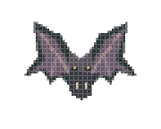 | Bat | 1 | 10 | 7 | 1 | 14 | Melee; flying artwork |
| 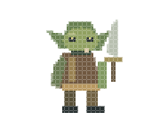 | Goblin | 1 | 22 | 9 | 2 | 22 | Melee |
| 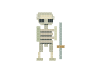 | Skeleton | 1 | 28 | 12 | 4 | 32 | Melee |
| 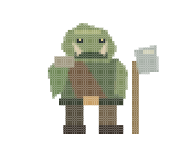 | Orc | 1 | 40 | 16 | 5 | 50 | Melee |
| 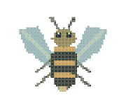 | Wasp | 2 | 18 | 8 | 1 | 20 | Ranged stinger, 3 tiles |
| 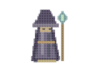 | Mage | 4 | 25 | 10 | 2 | 28 | Magic attack, 4 tiles |
| 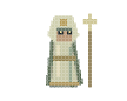 | Healer | 5 | 30 | 6 | 3 | 35 | Heals self/allies, 3 tiles; melee fallback |

For dungeon depth `d`, ordinary monsters scale as follows:

- HP: `round(base HP × (1 + 0.20 × (d − 1)))`.
- ATK: `round(base ATK × (1 + rate × (d − 1)))`; rate is `0.10` for ranged/magic enemies and `0.15` otherwise.
- DEF: `base DEF + floor((d − 1) / 2)`.
- XP: `round(base XP × (1 + 0.35 × (d − 1)))`; gold: `max(2, round(5 × (1 + 0.35 × (d − 1))))`.

ATK is a stat, not guaranteed damage: melee subtracts the hero's effective defense, while the current ranged/magic branches use their own hit/dodge checks and do not subtract armor. The Healer restores 15% of a patient's maximum HP, preferring the lowest HP ratio among eligible allies or itself with line of sight. Enemy attack attempts share a per-monster 0.8-second cooldown.

### Companion

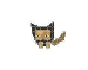

**Marmalade** joins beside the town gate or automatically on the first descent. Every three active seconds it attacks for 1 damage, or 2 against its preferred target, bats. It follows between areas, adds a two-tile light radius, and comments in bubbles and the log. The first defeated boss replaces it; boss companions deal exactly 1 damage every three active seconds. Companions are run progression, not separate floor rewards that can be farmed on return.

<details>
<summary>Boss artwork, encounter stats and throne room (spoilers)</summary>

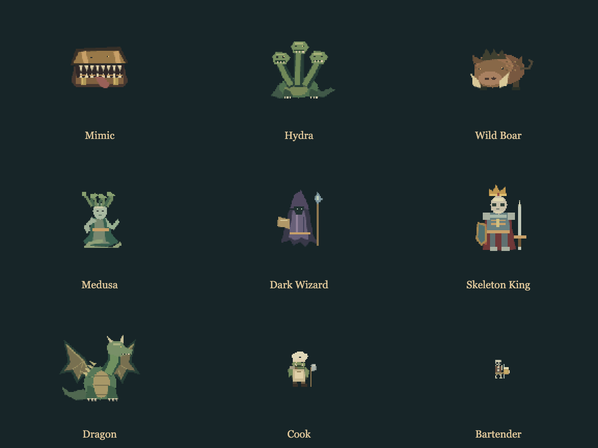

These are **actual scaled encounter stats at each listed depth**, not base values. Rewards are once per floor; defeated bosses stay defeated on return. Large artwork still has single-tile targeting and collision.

| Figure | Depth | Boss | HP | ATK | DEF | XP | Gold | Ability |
| --- | ---: | --- | ---: | ---: | ---: | ---: | ---: | --- |
| 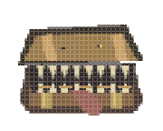 | 5 | Mimic | 118 | 30 | 4 | 240 | 160 | Melee |
|  | 10 | Hydra | 229 | 49 | 5 | 488 | 325 | Melee |
| 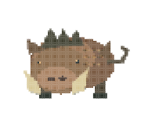 | 20 | Wild Boar | 426 | 89 | 8 | 978 | 661 | Melee |
|  | 30 | Medusa | 515 | 118 | 9 | 1444 | 990 | Magic attack, 4 tiles |
| 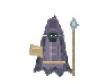 | 40 | Dark Wizard | 682 | 167 | 11 | 1989 | 1398 | Magic attack, 5 tiles |
|  | 50 | Skeleton King | 1032 | 212 | 15 | 3339 | 2385 | Bone projectiles, 6 tiles; summons skeleton guards |
|  | 60 | Hydra | 929 | 219 | 16 | 3071 | 2205 | Melee |
|  | 70 | Wild Boar | 1299 | 277 | 19 | 3833 | 2738 | Melee |
|  | 80 | Medusa | 1310 | 300 | 20 | 4565 | 3320 | Magic attack, 4 tiles |
|  | 90 | Dark Wizard | 1518 | 381 | 22 | 5348 | 3953 | Magic attack, 5 tiles |
| 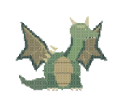 | 100 | Dragon | 2061 | 438 | 24 | 6438 | 5150 | Melee |

Themed encounters add the **Cook** in the depth-3 Orc's Kitchen and **Bartender** in the depth-7 Skeleton Pub. Their defeat is optional for descent; the floor key is still required. They use Orc/Skeleton-derived chef and bartender designs; their gameplay remains unchanged.

| Figure | Depth | Encounter | HP | ATK | DEF | XP | Gold | Ability |
| --- | ---: | --- | ---: | ---: | ---: | ---: | ---: | --- |
| 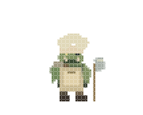 | 3 | Cook | 140 | 26 | 6 | 255 | 170 | Melee |
| 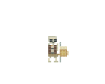 | 7 | Bartender | 220 | 38 | 7 | 465 | 310 | Thrown beer, 4 tiles |

The Skeleton King has a dedicated 24×18 throne arena with a dais, torch rows, banners and guard alcoves. This screenshot uses a fresh generated floor and prepared camera/exploration to show the room; the hero stats are not an endgame balance example.

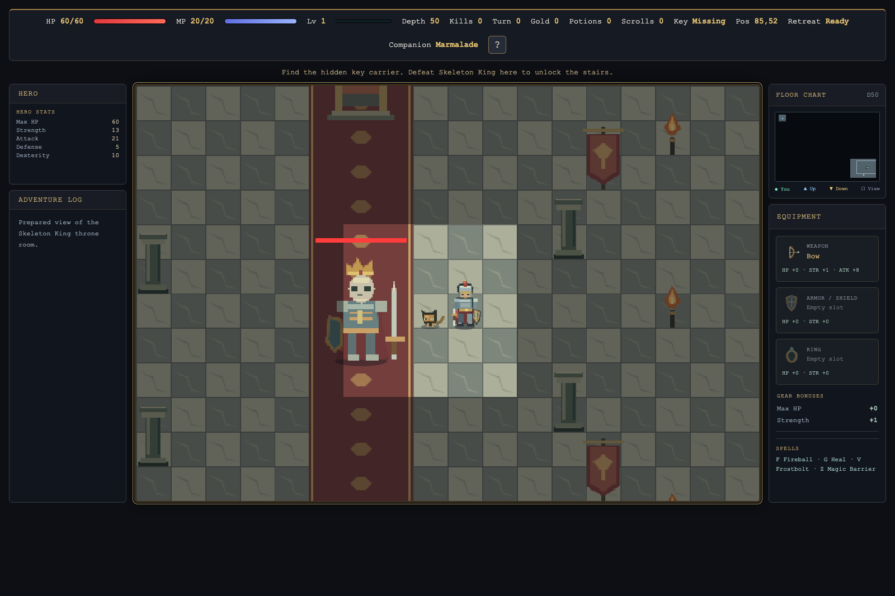

</details>

## Magic and ranged attacks

Fireball and Heal are known at the start. Learn the other spells by collecting/buying their tomes from the listed minimum depth; already-known tomes are skipped without charging again. Costs and cooldowns below are for ordinary play. Cooldowns count active dungeon time.

| Key | Spell | MP | Cooldown | Range / target | Effect | Unlock |
| --- | --- | ---: | --- | --- | --- | --- |
| F | Fireball | 8 | 1.5 s | All eligible enemies within 3 tiles | `max(1, round(A × 0.8) − floor(D / 2))` each; no stun | Starting spell |
| G | Heal | 12 | 2 s | Self | Restore 30% maximum HP, rounded and capped | Starting spell |
| V | Frostbolt | 10 | 3 s | Nearest eligible enemy within 4 tiles | `max(1, round(A × 1.6) − floor(D / 2))`; no slow effect | Tome, depth 2+ |
| B | Greater Heal | 18 | 6 s | Self | Restore 55% maximum HP, rounded and capped | Tome, depth 4+ |
| Z | Magic Barrier | 14 | 4 s | Nearest eligible enemy within 3 tiles | Push up to 3 tiles; blocked push deals `max(2, round(A × 1.4) − floor(D / 2))` | Tome, depth 5+ |

`A` is effective hero attack (strength including gear, plus equipment attack); `D` is the target's defense. Targeted attacks require line of sight, current visibility and camera eligibility. Range uses the larger of horizontal/vertical tile distance, so diagonals count as one tile. Frostbolt and Magic Barrier choose the nearest eligible enemy; equal tile distances choose the lowest monster ID. Target selection does not reorder the monster list or consume random numbers. A fully successful Barrier push deals no damage. Healing always restores at least 1 HP before the maximum-HP cap. Casting into empty air or at full HP still spends MP and starts the cooldown.

Mana regenerates **1 MP every two active seconds**, after four seconds without combat and with no living monster within three tiles. Town freezes passive regeneration; the Inn restores HP and MP fully.

**Bow (E):** equip a Bow in the weapon slot, then shoot the nearest eligible visible enemy within three tiles and line of sight. It adds 8 attack and 1 strength; damage is `max(1, effective attack − target defense)`. It does not use MP.

**Town Scroll (J):** consumes a stored scroll rather than MP. It opens one return portal at the town gate; using it returns to the saved dungeon tile once. It is an item, available as rare loot and Store stock, rather than a learned spell.

## Ending

The final princess interaction starts a roughly 14-second canvas sequence. Dungeon simulation stops during the animation and the final scene. **Esc** or **Skip to sunset** jumps to the final scene; **R** or **New adventure** starts a fresh run. The generic victory overlay does not cover the animation. Switching away from the tab pauses its clock, and sound/mute controls still work.

<details>
<summary>Plot twist (spoilers)</summary>

The princess is in love with the dragon. She runs past the hero, heals her wounded partner, climbs onto him, and they fly away together. The heartbroken hero then walks toward the setting sun, shrinking into the distance and crying blue tears. The sunset holds with **THE END** and run stats.

</details>

## Equipment

The right sidebar shows weapon, armor/shield, and ring slots with icons, each item's modifiers, combined HP/strength bonuses, and effective hero stats.

- A **Sword** adds 6 attack and 2 strength; strength also contributes to attack, so its total attack increase is 8.
- A **Shield** occupies the armor slot and adds 5 defense, reducing melee monster hit damage by 5 compared with the same hero without that shield, down to the minimum of 1 damage. Armor and helmets remain alternative defensive gear.
- A **Ring** adds 20 maximum HP and 20 current HP when first equipped, plus its existing attack/defense/strength/dexterity modifiers. Replacing it with another equal ring does not stack or grant another heal. Removing or selling it removes the maximum-HP bonus and caps current HP at the resulting maximum.

A **Bow** adds 8 attack and 1 strength; **Armor** adds 4 defense and 1 strength; a **Helmet** adds 2 defense and 2 dexterity. Armor, Helmet and Shield compete for the same slot. An **Elixir** permanently adds 2 strength and 2 dexterity. A stored **Potion** restores 35% maximum HP when used.

Collecting or buying gear equips it; selling removes its modifiers. Floor changes preserve equipment and bonuses. HP and strength modifiers appear even when zero, and the hero stats show the resulting totals.

## Development and checks

Runtime files: `index.html`, `style.css`, `js/sprites.js`, and `js/game.js`. Both scripts share global scope; preserve their order and `file://` compatibility. See [agent guidance](agents.md), [tasks](tasks.md), [handover](handover.md), [changelog](CHANGELOG.md), and the [2026-11-24 review](docs/reviews/2026-11-24-status-review.md). The graphics pass passed 138 behavior tests, syntax and external smoke checks, plus Chrome `file://` checks covering movement, travel, dialogs, all boss kinds and the ending. A seeded comparison also preserves town/floor gameplay data. A full human campaign and subjective audio playtest remain open.

Run the dependency-free checks with Node.js:

```sh
node --check js/game.js
node --check js/sprites.js
node --test tests/game.test.cjs
```

The existing environment-specific startup smoke test remains outside the repository:

```sh
node /var/folders/lp/737kz569419gglsqmvs0x0200000gn/T/opencode/smoke.js
```

Also check actual rendering, controls, dialogs, and sound in a browser after gameplay changes.
