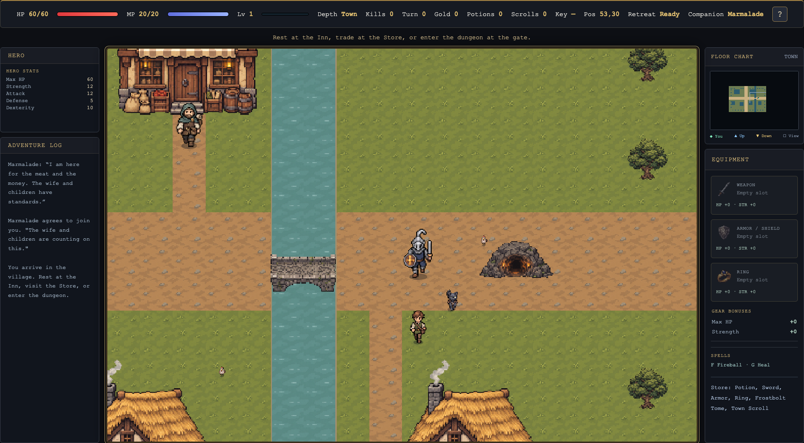
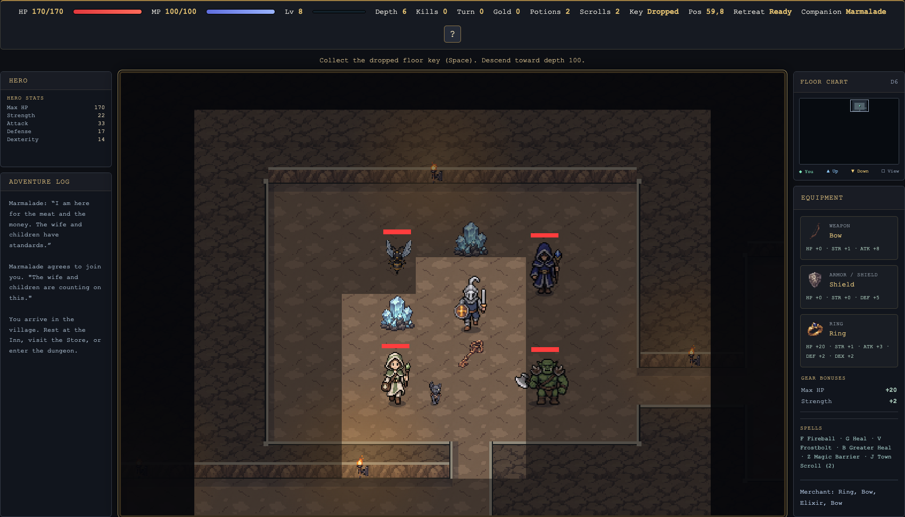

# Dungeon Crawler

A fantasy dungeon adventure with a talking cat, dangerous monsters and 100 floors to explore. **Version 2.1.0 — alpha.**

## Play

[Download the 2.1.0 alpha release](https://github.com/VAdamec/dungeon-crawler-inkling-2-mini/releases/tag/2.1.0), unzip it, and open **index.html** in your browser. No installation, account or internet connection is needed to play. Start in the village, meet your companion near the gate, then enter the dungeon.

## Controls

| Key | Action |
| --- | --- |
| Arrows / WASD | Move; walk into a monster to attack |
| Space | Talk, collect, open a shop or use stairs |
| Q / Backspace | Go up while standing on ▲ |
| H | Drink a stored potion |
| E | Shoot an equipped bow |
| F / G / V / B / Z | Fireball / Heal / Frostbolt / Greater Heal / Magic Barrier |
| J | Use a Town Scroll or return through its portal |
| Enter | Request retreat; Y confirms, Esc cancels |
| X | Open a shop’s Sell list |
| ? | Help, music and sound settings |
| Esc | Close Help, continue from a health pause, or skip a cinematic |
| R | Start a new adventure |

## Before you descend

- Rest at the Inn to restore health and mana; visit the Store for supplies. Choose purchases and sales, then Confirm; Cancel discards the cart.
- A monster carries each floor's key. Defeat it, collect the key, then use ▼ to descend.
- Potions stay in your inventory until you drink them. Low health pauses the action so you can decide what to do.
- Watch for fire and falling rocks. Some traps stay hidden until stepped on.
- Save your adventure from **? → Save game**. Keep the downloaded `.json` file; use **Load game** in Help or **Load adventure** on the start/death screen to continue. Review the file, then confirm Load.
- There is no autosave. Restarting or reloading clears unsaved progress; Cancel keeps your current adventure.

*This encounter is staged to show the monsters and equipment.*

Alpha testing is in progress.

[Player guide, bestiary and spells](docs/PLAYER_GUIDE.md) · [Credits](CREDITS.md) · [Developer documentation](DOCUMENTATION.md) · [Changelog](CHANGELOG.md)
