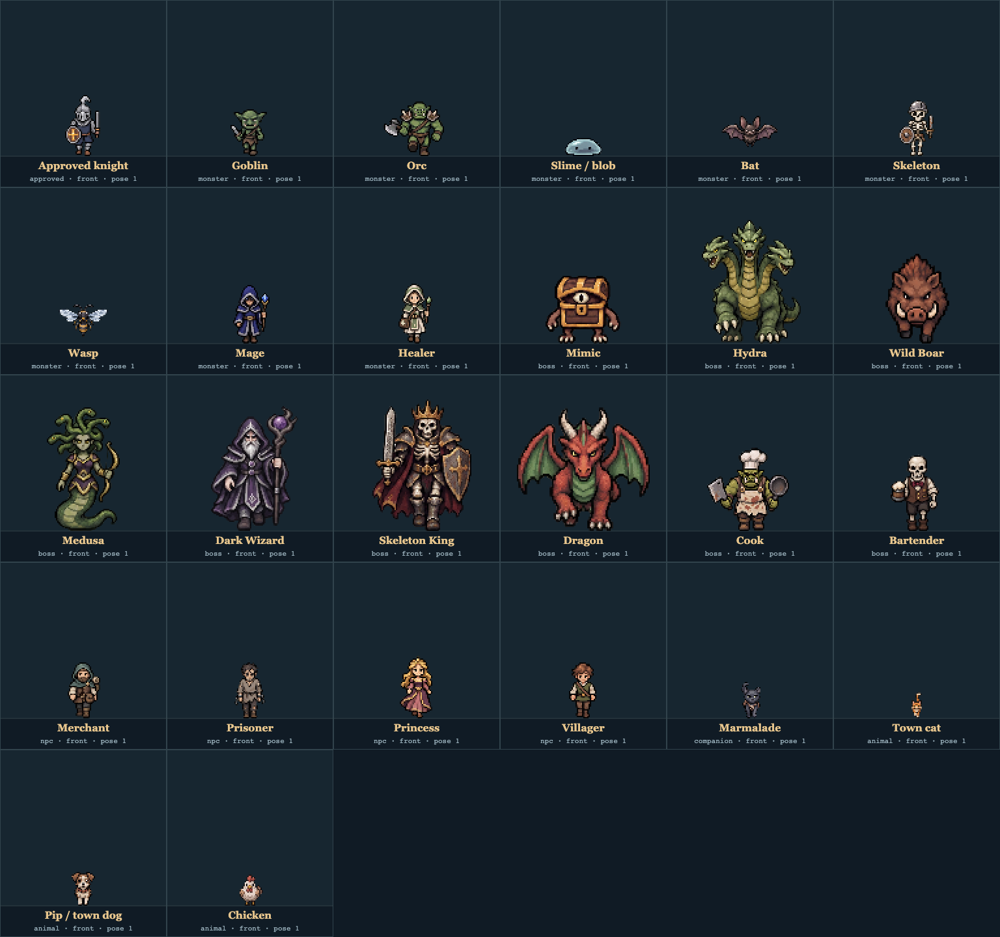
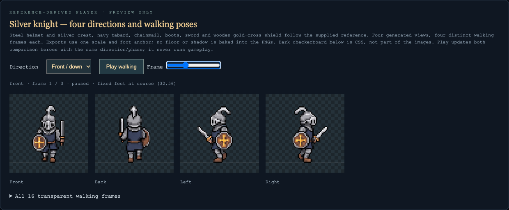
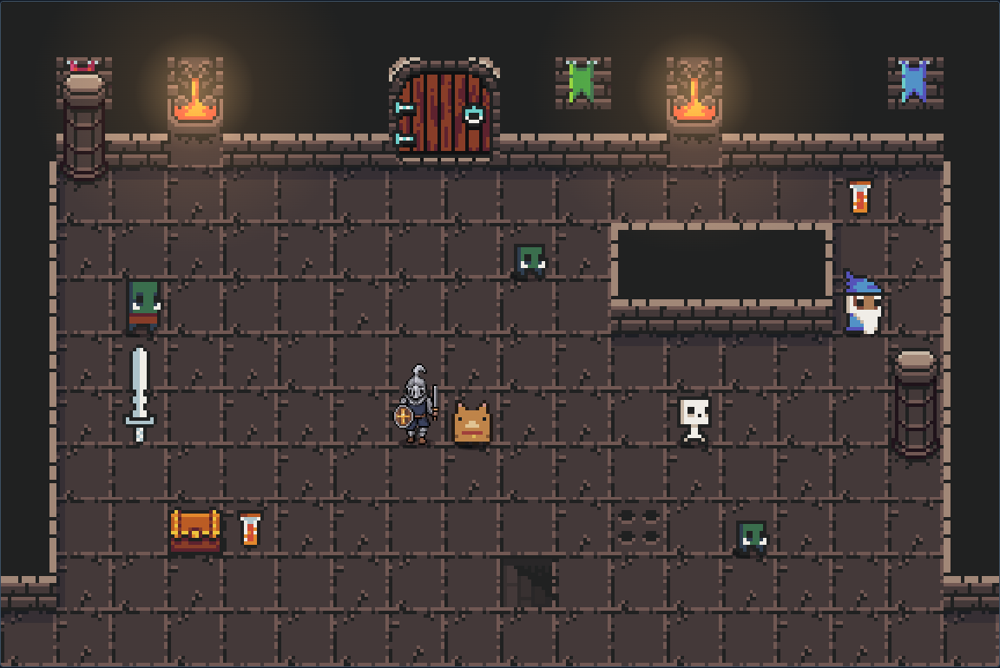
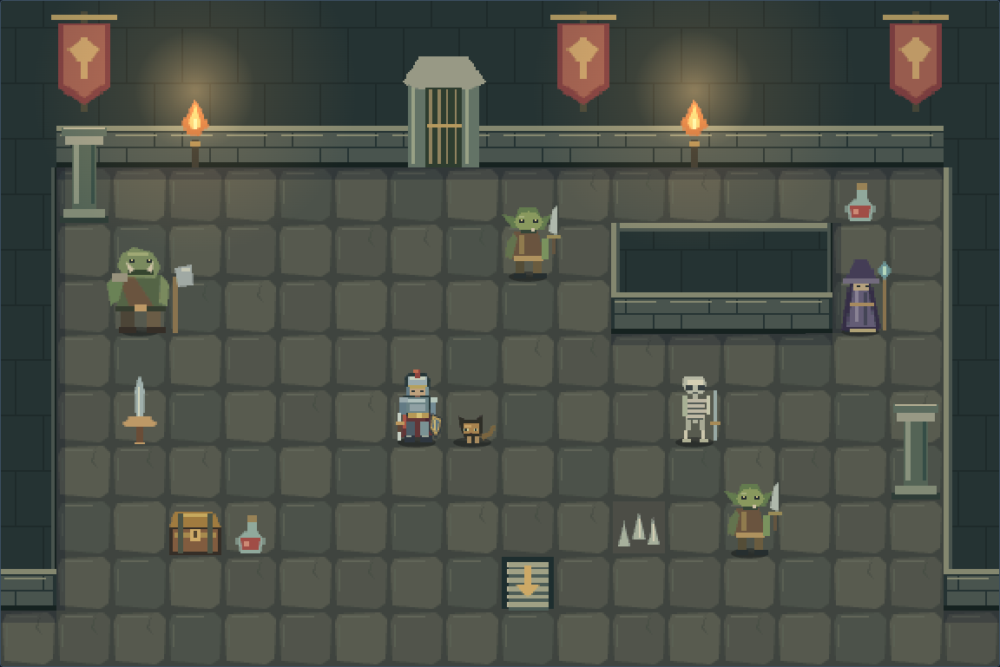
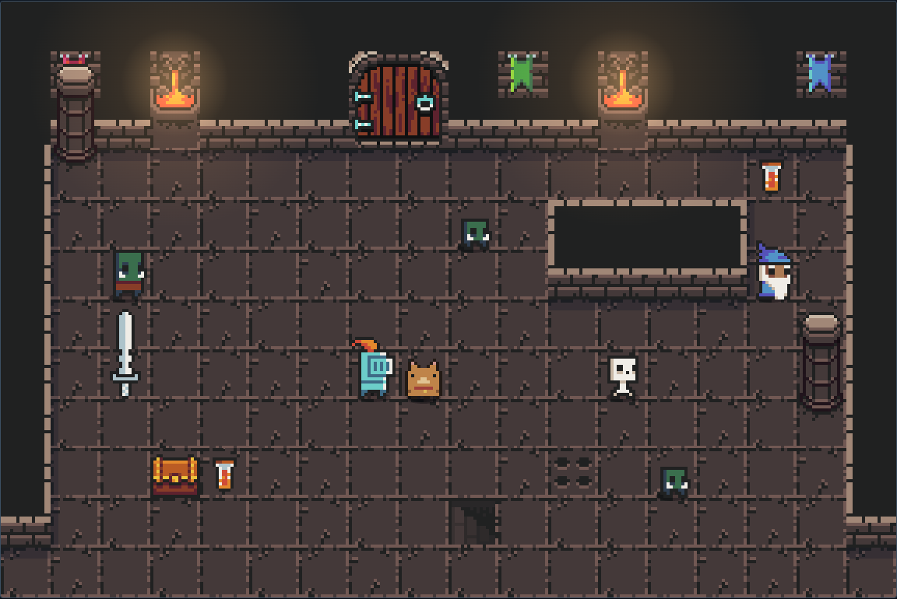
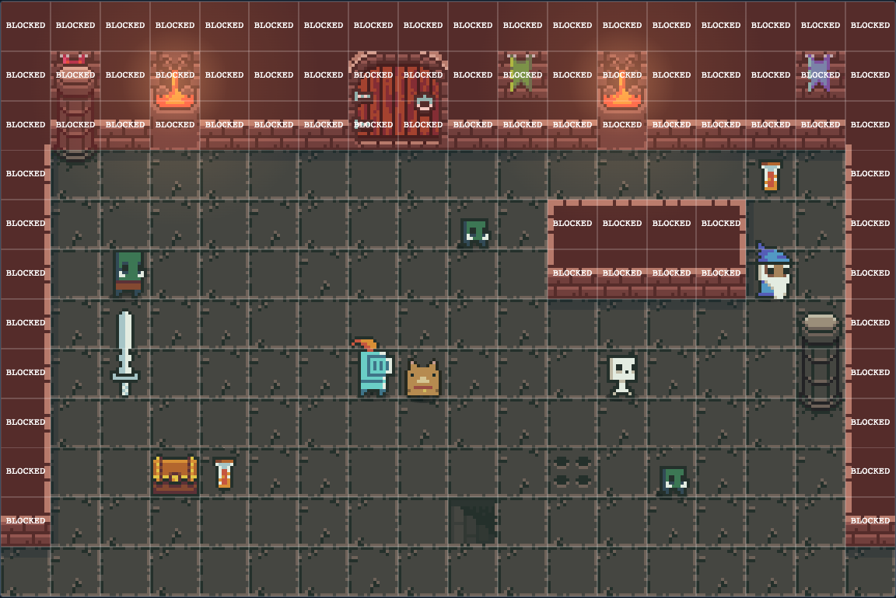
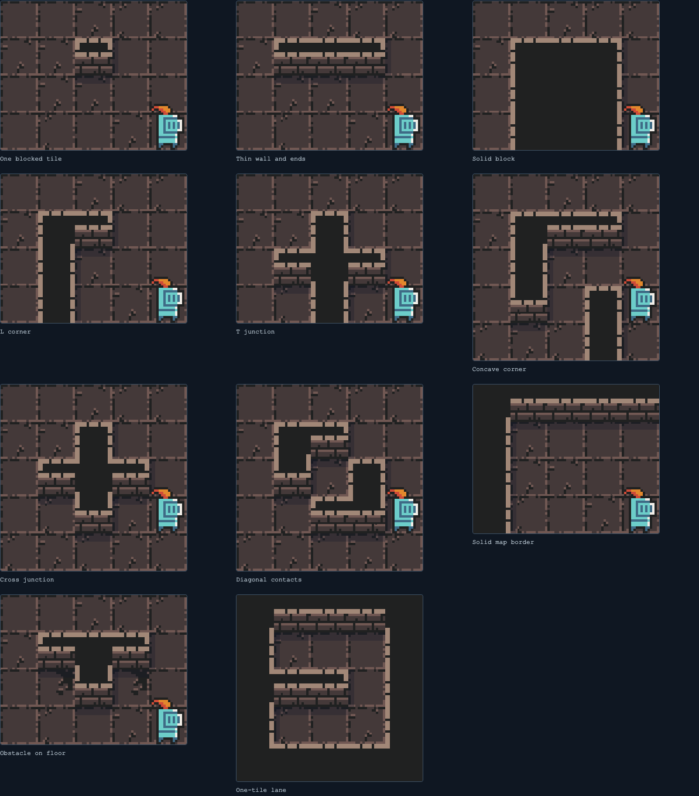

# 0x72 preview progress — revision 3

Updated 2026-11-25. **Preview-only changes; playable release remains 1.0.1.**

[Open current offline preview](design-v3.html) · [Design](../../plans/2026-11-25-0x72-graphics-design.md) · [Tasks](../../plans/2026-11-25-0x72-graphics-plan.md) · [Original draft review](../../reviews/2026-11-25-0x72-draft-review.md)

## Latest addition — full character collection

The user approved the knight and requested the remaining monsters, bosses and NPCs in the same style, with no runtime changes. Additional references specified the red/green dragon, boar, green orc/goblin, pale blue blob, **charcoal harness-and-satchel Marmalade**, and gold-banded wooden Mimic. Prepared **25 additional sheets / 400 transparent frames**: eight ordinary monsters, nine unique bosses, four NPCs, Marmalade and three town animals. Every role has front/back/left/right views and four appropriate motion phases. Knight remains the approved style anchor; the new collection awaits review.

[Interactive character gallery](characters.html) · [Overview](characters-v1/review/overview.png) · [Coverage, exact prompts and export instructions](characters-v1/README.md). The main dungeon comparison and stone-outpost NPC scene also use the new figures. Source-pack character strips are labeled as superseded reference material, not selected art. The source inventory now links prepared proposed sheets while retaining the unchanged 1.0.1 runtime dimensions/frame counts.

The exporter uses one scale per character, transparent margins, documented fixed feet/hover centers and explicit large-boss bounds. Blob hopping, bat/wasp wingbeats, Medusa slithering, Mimic's closed/eye/open/movement states and walking feet are actual pose differences, not recolors. Mimic's first column was corrected to retract all limbs; wasp wing-edge artifacts received a targeted generation cleanup. Selected generations, prior correction sources and all prompts remain in the workspace. These generated adaptations are separate from the 0x72 CC0 pack.

**17 preview checks pass**. Standard file:// Chrome verifies all 25 cards, group counts (8 monsters / 9 bosses / 4 NPCs / 1 companion / 3 animals), every direction/frame, playback/pause/hidden-page guard, dragon alias, missing-role failure and the updated dungeon/NPC scenes, with no browser errors or remote requests. [Browser evidence](characters-v1/review/browser.json). Production HTML/CSS/scripts, game tests, approved knight sprites and unrelated local-LLM gameplay drafts remain unchanged. The last 155-test game result remains historical; there were no game-source changes requiring a new run in this asset-only pass.



## Latest addition — user-reference knight

The user selected the silver-helmet/navy-tabard knight reference and requested transparent four-direction walking sprites in this preview, with no runtime changes. Prepared **16 distinct frames** (front/back/left/right × four walking phases), four transparent direction strips and a combined sheet under [knight-reference-v1](knight-reference-v1/README.md). The generated source is retained, along with the [exact prompts](knight-reference-v1/prompts.md), deterministic export script and crop/alpha/hash manifest. This is a generated reference adaptation, separate from the CC0 pack.

The main proposed scene now uses this knight. Direction/frame controls update both comparison heroes together; Play/Pause uses the same phase in each style. A four-view review board and transparent full sheet make the walking loops inspectable. Exports use one shared nearest-neighbor scale, 64×64 cells and fixed feet at (32,56), with a maximum visible body height of 48px; the preview draws at 2× screen scale. Actual alpha bounds are recorded for every frame. The finer pixel density is intentional for this more detailed reference and remains a visual review point.

**11 preview tests pass**: the six wall/manifest checks plus five knight checks for all 16 unique poses, transparent margins/feet, changing lower-body silhouettes, sheet/strip/frame equality and RGBA round trips. Standard file:// Chrome verified all directions and frames through actual controls, walking advance, pause and hidden-page freeze, with no errors or remote requests. [Browser evidence](knight-reference-v1/review/browser.json). Production and unrelated draft hashes remain unchanged. Full game tests were not rerun for this asset-only addition; the 155-test baseline above/below is historical and game/test sources are unchanged.





## Changes addressing the draft review

- Replaced cap rows with a connected low-wall derivative using actual pack coping, stone-top and brick-face crops. Every blocked cell has an opaque top surface; no floor is drawn underneath it. All wall painting stays inside the blocked tile. The eight-neighbor selector handles relevant diagonals, normalizes 256 inputs into 47 patterns, and treats outside the map as solid and obstacles as floor.
- Added eleven fixtures: isolated tile, line/ends, thick block, L/T/cross, concave/diagonal contacts, border, obstacle adjacency and one-tile corridor. The collision-grid button labels blocked cells in the scene and fixtures. This is a visual fixture, not a new gameplay collision implementation.
- Removed separate before/after prop arrays and hand-tuned old prop scales. Both styles now use the same semantic fixture, positions, foot anchors, illumination, contact shadows and fog mask. Non-equivalent monster substitutions and an undersized boss sample were removed from the controlled pair. Native art dimensions deliberately differ and are calculated in the size ledger. Marmalade's baseline uses the actual 1.5 companion scale.
- Both fog variants use the same illustrative mask; it is explicitly labeled as an approximation, not live-game visibility verification. Grayscale and exact 1152×768 canvases remain available. The new walls are modified/composited art, not claimed to be an unchanged autotile atlas layout.
- Default index.html now opens v3 without fetch or a security override. v2 is labeled superseded. The old experimental inspection pages and preview.js are historical artifacts, not the canonical entry point.
- Corrected all 76 role frame counts (including the generator's array.length/Set.size mistake), density units, goblin directions and torch-source notes. One generated inventory feeds the preview; builders resolve copied repository sources relative to their own location, not Downloads. Corrected provenance byte sizes and high-wall reference status.
- Missing/out-of-range crops and unknown required roles now fail visibly. Required-role/crop/fixture assertions run before reporting success. A static checks panel alone is no longer the only evidence: independent geometry tests and actual browser results are recorded.

## Verified results

- Six dependency-free preview tests pass: 256-mask normalization, diagonal joints, boundary/obstacle meaning, transformed paint bounds for every raw mask, manifest units/frames and crop bounds/local entry.
- Builders successfully run from /tmp using their absolute script location. No user-specific paths are required in the builders; optional browser tooling can be supplied through OX72_PLAYWRIGHT.
- Standard Chrome file:// check (no relaxed file-access flag): canonical index redirects to v3; 56 canvases and 76 role rows render; 458 preparation checks complete; missing crop intentionally throws; collision toggle works. No page errors or HTTP(S) requests. [Browser evidence](v3/browser.json).
- All 155 existing game tests pass after this revision. Hashes of index.html, style.css, js/game.js, js/sprites.js and tests/game.test.cjs match the start of this preview revision. Unrelated companion/teleportation/implementation/trading drafts also remain untouched.
- Added a reproducible read-only game benchmark and [measured baseline](baseline-1.0.1.json): fresh-page-to-launch-visible about 70ms, warm static draw+minimap median 0.4ms / p95 0.5ms; 448 cached canvases, about 1.93 MiB of RGBA canvas storage. This is a single-machine static-clock baseline with a warm filesystem, not a cold-machine or animated-game performance guarantee. Seed, viewport, browser, source sizes and method are recorded for later comparison.

## Reproduce

From the repository root:

```sh
node docs/previews/2026-11-25-0x72/build-data.mjs
node docs/previews/2026-11-25-0x72/build-design-data.mjs
node --test docs/previews/2026-11-25-0x72/verify-preview.cjs
```

Open index.html in this preview folder directly in a browser. No packages, server, build or security override are required to view it.

Optional browser evidence tools require an existing Playwright installation outside the runtime. Set OX72_PLAYWRIGHT to its module directory if it is not resolvable as `playwright`, then run:

```sh
node docs/previews/2026-11-25-0x72/check-browser.cjs /tmp/ox72-preview-check
node docs/previews/2026-11-25-0x72/measure-baseline.cjs /tmp/ox72-game-baseline.json
```

On this host, Node currently needs the documented DYLD_LIBRARY_PATH workaround; no system files were changed. Do not overwrite the recorded 1.0.1 benchmark when measuring a later renderer.

## Current scope and remaining work

OX-01 has verified source copies, a corrected inventory and initial measured baseline; a complete role-specific usage/bounds/custom-production manifest still needs expansion. OX-02 now has revised wall/comparison evidence for visual review. The knight is approved, and all 25 remaining character sheets now have directional motion loops prepared for review. Full town buildings/landscape, items, terrain variants, effects and any additional cinematic-specific poses remain separate unfinished work; their manifest statuses mean required work, not completed art. OX-03–08 are not complete, no unseen collection is approved and no runtime integration is authorized by this revision.

## Controlled captures

Before:



After:



Collision overlay:



Topology fixtures:




## Item/effect corrections — 2026-11-25

User reviewed the characters, supplied town and item/effect references, then requested correction/completion of missing or incorrect artwork. Added a separate [item/effect gallery](items-effects.html) with 31 generated asset families, source prompts, transparent frame exports and a deterministic exporter. Corrected whole-wasp/stinger confusion, hidden spike secrecy, duplicated/misleading item/spell labels, Magic Barrier push semantics, ordinary chest states, torch mount and clear up/down stairs. Closed portal and hidden spikes are actual all-zero RGBA frames. The gallery proves hidden-floor pixel identity and shows every asset beside the approved knight at proposed screen scale. The standalone dungeon uses the new chest/potion/sword/stairs and genuinely hidden spikes. Production remains untouched.

The town reference is saved for a later architecture/material pass. Biomes, town buildings and any extra cinematic poses remain pending; the new item/effect collection awaits review. No runtime integration or version change. See [asset notes and exact prompts](items-effects-v1/README.md).

Verification: 22 dependency-free preview tests pass (5 new item checks plus the existing 17). Standard Chrome over `file://` verifies all 31 cards/categories, five selectable phases, play/pause, hidden-tab freeze, pixel-identical hidden spikes, PNG overview export and the revised dungeon scene, with no browser errors or remote requests. Export contains 72 transparent frames. SHA-256 comparison confirms all 603 protected production/test/draft/approved-character PNG files unchanged. Game behavior tests were not rerun for artwork-only changes; production bytes are unchanged. [Browser evidence](items-effects-v1/review/browser.json) · [Overview](items-effects-v1/review/overview.png).


## Final town/biome composition — 2026-11-25

[Final preview](final-preview.html) now opens from the preview index. Added 24 environment families and six structural material atlases; refined floor cluster scale after actual map renders to reduce noise. The town has generated timber/plaster buildings, cottage, stone bridge, trees and cave gate. Nine scene views combine these with the reviewed hero/creatures/NPCs and corrected items. Current game town/floor/arena coordinates are captured in `environment-v1/fixtures.json`; actor/extra prop staging is labeled. Flat building backdrops were removed, bridge width corrected to its two crossing tiles, and saved throne grave props use pillars like the current renderer.

[Complete source ledger](environment-v1/final-coverage.md) maps all 76 current runtime roles. [Implementation plan](../../plans/2026-11-25-final-graphics-implementation-plan.md) covers source anchors, transparent padding, explicit boss scales, exact doors, trap/portal states, bake/runtime architecture and cinematic acceptance. New art awaits final visual acceptance; no runtime integration or version change. Historical v3 and character/item review tools remain linked and target their original pages directly.


Verification: all 27 dependency-free preview tests pass. Standard `file://` Chrome renders nine scenes, six material swatches, all facing/pose controls, pause/hidden-tab freeze, collision/fog/portal controls and PNG export. Mobile fits the viewport. All 1,280 raw wall-mask/material cases are opaque within the blocked tile and transparent outside. Zero browser errors or remote requests; recorded fixture data stays unchanged. SHA-256 checks confirm 749 protected production/test/draft/prior-artwork files unchanged. Existing game behavior tests were not rerun for artwork-only preparation. [Verification summary](environment-v1/verification.json) · [browser evidence](environment-v1/review/browser.json) · [contact sheet](environment-v1/review/final-contact.png).
