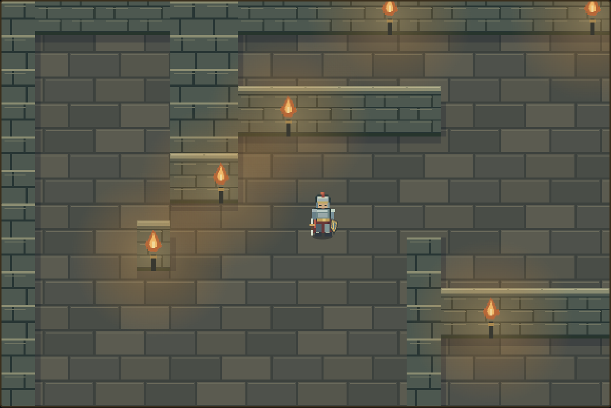
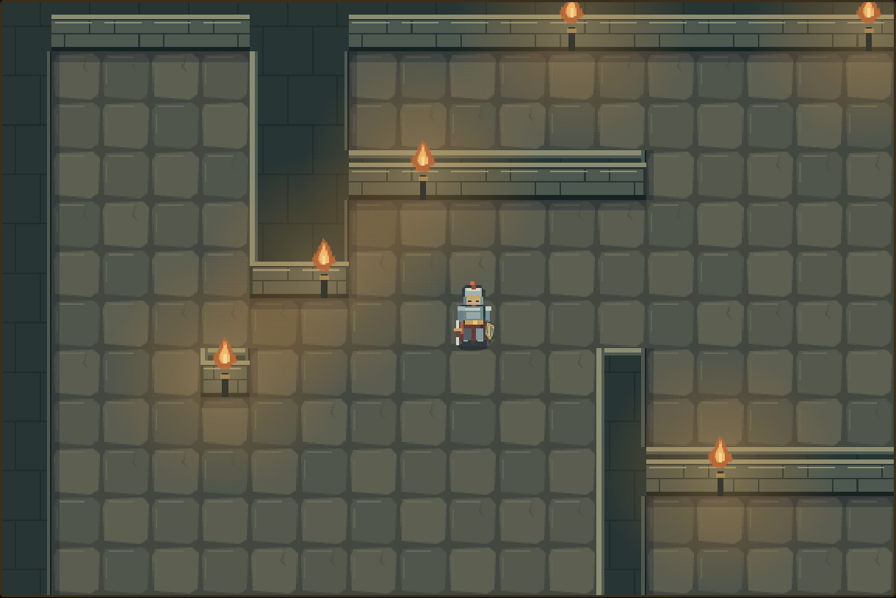
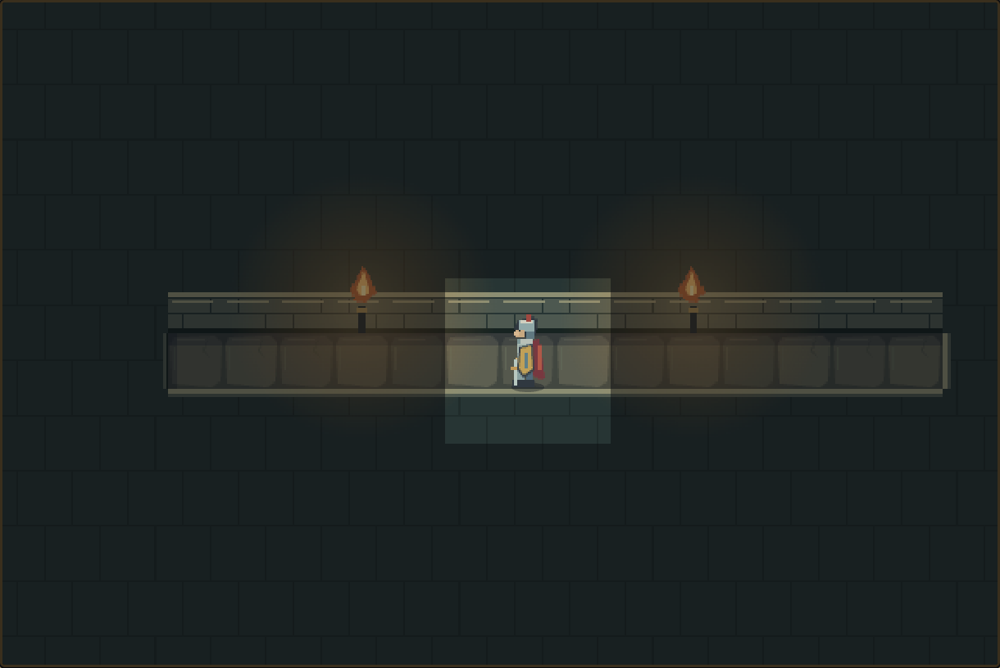

# Wall rendering correction — 2026-11-24

The reported screenshots showed two problems: repeated isolated brick panels inside solid walls, and a 48px wall face drawn across a 32px blocked tile. That overhang covered 16px of the tile to the north, which could be walkable. Brick-like crypt floor rows also made the walkable surface resemble wall masonry.

Walls now use exposed neighbor edges and continuous dark top planes. Only floor-facing edges receive a lower facade; every wall primitive remains inside its blocked tile. Tile caches distinguish neighbor topology. Crypt floors use chipped flagstones. Town art, map/collision data, actor sizes, movement interpolation, fog rules, torch animation and gameplay rules are unchanged.

## Verification

- All 155 Node behavior tests pass. Four new regressions check rectangle/inner-corner/obstacle adjacency, every edge mask across five wall materials staying within 32×32 without RNG/state mutation, cache separation/reuse after a neighbor changes, and a one-tile corridor with blocked sides/ends.
- Both script syntax checks and external `SMOKE_OK` pass.
- Actual file:// Chrome captures cover crypt/cavern/kitchen/tavern walls. Arrow keys move east/west along a one-tile corridor, reject north/south walls and stop at the closed end. The throne room renders, Help opens/closes and R returns to town. No browser errors or network requests occurred.
- This corrects a rendering overlap; the existing movement collision check already rejected blocked tiles and remains unchanged. Tall character bodies can still overlap wall art above their feet, as expected for foot-anchored sprites.

## Controlled comparison

These are prepared runtime fixtures, not a generated campaign layout. Before/after share the same blocked tiles and player position; fog is disabled in this comparison to expose all joins. The corridor capture retains normal fog.

Before:

After:

One-tile corridor:

